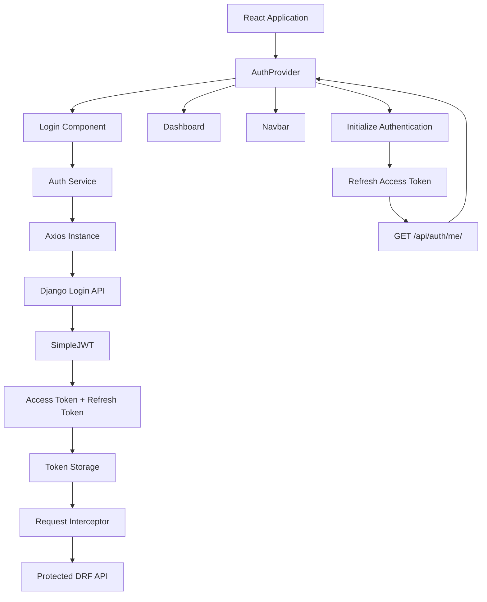
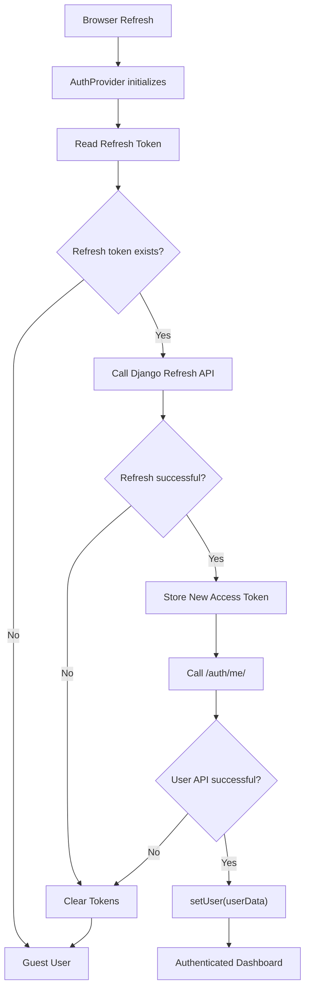

# React + Django Integration With Axios & ContextAPI 

```code

frontend1/
│
└── src/
    ├── api/
    │   └── axiosInstance.js
    ├── services/
    │   └── authService.js
    ├── context/
    │   └── AuthContext.jsx
    ├── components/
    │   ├── Navbar.jsx
    │   └── ProtectedContent.jsx
    ├── pages/
    │   ├── Login.jsx
    │   └── Dashboard.jsx
    ├── App.jsx
    └── main.jsx
```

## AuthProvider Utilation



## Authentication Persistence

