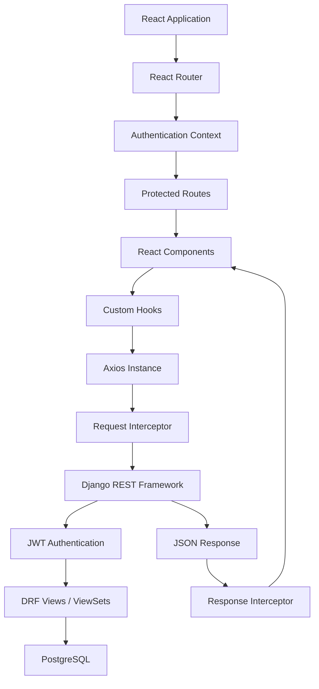

# React + Django REST Framework — Advanced Integration Lab 🚀

**Duration:** 8 Days  
**Phases:** 8  
**Project:** TaskFlow — Full-Stack Task Management System

### 💻 System architecture

## Day 1 — Context API and Global Authentication State

**Topics**
- `createContext`
- `useContext`
- Context Provider
- Global state sharing
- Provider composition

**Backend integration**
- Django JWT authentication.
- Login API.
- Registration API.
- Current authenticated user API (`/api/auth/me/`).
- Logout functionality.

**Practical implementation**
1. Create an AuthContext.
2. Create an AuthProvider.
3. Implement login and registration.
4. Store authentication state globally.
5. Access authenticated user information from different components.
6. Implement logout.
7. Handle loading and authentication states.

**Deliverable:** A centralized authentication system accessible throughout the React application.

---

## Day 2 — React Router and Protected Routes

**Topics**
- React Router
- `createBrowserRouter`
- `RouterProvider`
- `Navigate`
- `Outlet`
- `useNavigate`
- Nested routes
- Layout routes

**Backend integration**
- Authentication verification using DRF.
- Redirect unauthenticated users.
- Handle authenticated-only pages.

**Practical implementation**
1. Configure application routing.
2. Create public routes.
3. Create protected routes.
4. Build a reusable ProtectedRoute component.
5. Implement nested dashboard routes using Outlet.
6. Redirect authenticated users away from login and registration.
7. Handle unauthorized navigation.

**Deliverable:** A complete routing system with authentication-based access control.

---

## Day 3 — Axios and Axios Instances

**Topics**
- Axios fundamentals.
- GET, POST, PUT, PATCH, DELETE.
- Axios instances.
- Base URL configuration.
- Default headers.
- Request configuration.
- Error handling.

**Backend integration**
- Connect React to Django REST Framework.
- Implement CRUD operations.
- Work with DRF serializers and JSON responses.

**Practical implementation**
1. Install and configure Axios.
2. Create a centralized Axios instance.
3. Configure the Django API base URL.
4. Create API service modules.
5. Implement task creation.
6. Implement task retrieval.
7. Implement task updates and deletion.
8. Handle API errors.

**Deliverable:** A reusable API communication layer.

---

## Day 4 — Axios Request and Response Interceptors

**Topics**
- Request interceptors.
- Response interceptors.
- Authorization headers.
- JWT access tokens.
- Refresh tokens.
- Automatic token renewal.
- Retry failed requests.
- Interceptor cleanup.

**Backend integration**
- Django SimpleJWT.
- Access token endpoint.
- Refresh token endpoint.
- Authentication failure responses.
- Token expiration handling.

**Practical implementation**
1. Attach access tokens automatically to requests.
2. Detect 401 Unauthorized responses.
3. Request a new access token.
4. Retry the original failed request.
5. Prevent infinite refresh loops.
6. Handle refresh-token expiration.
7. Handle concurrent requests during token refresh.
8. Implement automatic logout when authentication expires.

**Deliverable:** An automated JWT authentication and token-refresh mechanism.

---

## Day 5 — React Custom Hooks

**Topics**
- Custom hook fundamentals.
- Rules of Hooks.
- Reusable stateful logic.
- API integration through hooks.
- Loading and error management.

**Practical implementation**
1. Create `useAuth()`.
2. Create `useApi()`.
3. Create `useFetch()`.
4. Create `useTasks()`.
5. Create `useDebounce()`.
6. Create `usePagination()`.
7. Reuse hooks across multiple components.

**Backend integration**
- DRF pagination.
- Search and filtering.
- API loading and error states.

**Deliverable:** Reusable React logic separated from UI components.

---

## Day 6 — useReducer and Advanced State Management

**Topics**
- `useReducer`.
- Reducer functions.
- Initial state.
- Actions.
- Dispatch.
- State transitions.
- Context + useReducer integration.

**Practical implementation**
1. Create a task reducer.
2. Define task actions.
3. Implement ADD_TASK.
4. Implement UPDATE_TASK.
5. Implement DELETE_TASK.
6. Implement SET_TASKS.
7. Implement loading and error states.
8. Integrate the reducer with Context API.

**Backend integration**
- Synchronize frontend state with DRF CRUD endpoints.
- Handle API success and failure.
- Maintain consistent UI state.

**Deliverable:** A centralized and predictable task state management system.

---

## Day 7 — useCallback, useMemo and useRef

**Topics**
- Referential equality.
- Memoization.
- `useCallback`.
- `useMemo`.
- `useRef`.
- React.memo.
- Performance optimization.

**Practical implementation**
1. Optimize task filtering.
2. Optimize search functionality.
3. Prevent unnecessary child component renders.
4. Memoize expensive calculations.
5. Stabilize callback references.
6. Use refs for DOM manipulation.
7. Implement search input focus.
8. Understand when memoization is unnecessary.

**Backend integration**
- Optimize search and filtering interactions.
- Avoid unnecessary API requests.
- Combine debouncing with API calls.

**Deliverable:** A performance-optimized React application.

---

## Day 8 — Lazy Loading and Suspense

**Topics**
- Code splitting.
- Dynamic imports.
- `React.lazy`.
- `Suspense`.
- Loading fallbacks.
- Route-based code splitting.
- Error boundaries.

**Practical implementation**
1. Lazy-load dashboard pages.
2. Lazy-load task management pages.
3. Configure Suspense fallbacks.
4. Split application routes.
5. Handle loading states.
6. Handle component loading failures.
7. Inspect production build output.

**Backend integration**
- Ensure API requests work correctly after lazy loading.
- Preserve authentication across route transitions.
- Handle loading and error states.

**Deliverable:** A production-oriented React application with route-based code splitting.

---

# Final Project Requirements

By the end of Day 8, TaskFlow should support:

- User registration and login.
- JWT authentication.
- Automatic access-token renewal.
- Protected routes.
- Dashboard.
- Task creation, retrieval, updating and deletion.
- Search and filtering.
- Pagination.
- Global authentication state.
- Centralized API services.
- Reusable custom hooks.
- Predictable state management.
- Performance optimization.
- Lazy-loaded application routes.